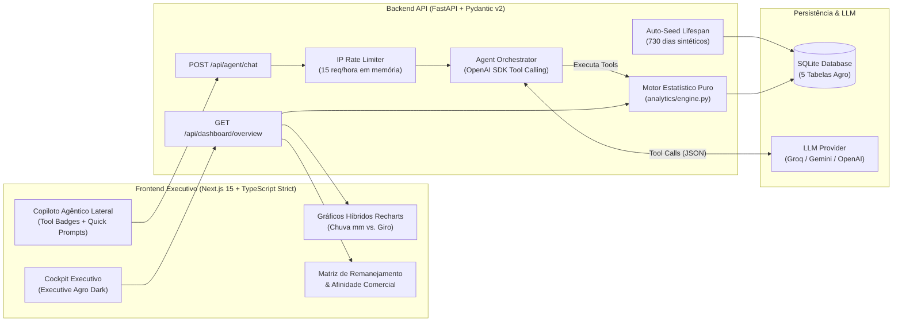

# 🌱 AgroPulse AI — Copiloto Agêntico de Inteligência Comercial e Estoque

[](https://github.com/agropulse-ai/agropulse/actions/workflows/ci.yml)


> **Live Demo de Portfólio (Full-Stack Monorepo):** Sistema agêntico de inteligência comercial e logística preditiva para distribuidoras de insumos agropecuários (Sementes de Pastagem, Nutrição Animal Águas/Seca e Defensivos). Cruza histórico de vendas (730 dias), cobertura de estoque em dias e telemetria pluviométrica (mm) para diagnosticar anomalias climáticas ($Z\text{-score}$), mapear a afinidade técnica de consultores e recomendar o remanejamento de lotes entre filiais antes da perda da janela agronômica de plantio.

---

## 🎯 1. O Problema de Negócio no Agronegócio

Distribuidoras de insumos agropecuários operam sob forte sazonalidade e janelas biológicas estreitas:
1. **Risco Climático e Perda de Janela de Plantio:** Um atraso severo de chuvas em uma microrregião (ex: **Filial Norte — Sinop/MT**) trava a saída de **Sementes de Pastagem** (queda $>50\%$) e dispara a demanda emergencial por **Nutrição Seca (Proteinado)**, deixando lotes milionários sob risco de perda de germinação/validade.
2. **Desequilíbrio Regional de Estoque:** Enquanto uma filial acumula cobertura crítica ($>65\text{ dias}$) por estiagem, outra filial com regime de chuvas regular (ex: **Filial Sul — Dourados/MS**) sofre com risco de ruptura iminente ($<8\text{ dias}$).
3. **Alocação Comercial Ineficiente:** Transferir um lote técnico sem direcioná-lo ao consultor certo destrói margem. **Especialistas Técnicos** entregam conversão e margem **35% a 45% superiores** em linhas técnicas (Sementes Premium e Defensivos) comparados a vendedores focados em volume de commodity (sal mineral básico com desconto).

---

## 🏗️ 2. Arquitetura do Sistema (Determinístico vs. Probabilístico)

O **AgroPulse AI** foi projetado sob uma regra arquitetural inegociável: **o LLM jamais realiza cálculos matemáticos**.

- **Camada Determinística (`backend/app/analytics/engine.py`):** Toda agregação financeira, cálculo de $Z\text{-score}$ sazonal, correlação de Pearson (chuva vs. vendas) e cobertura de estoque em dias roda em Python puro / Pandas / NumPy sobre o SQLite e é validada por contratos estritos `Pydantic v2`.
- **Camada Agêntica (`backend/app/agent/orchestrator.py`):** Utiliza exclusivamente o SDK padrão `openai` (sem *bloat* de LangChain ou CrewAI), compatível com **Groq**, **Google AI Studio (Gemini)**, **OpenAI** e **LM Studio**. O agente invoca as funções analíticas via *Native Tool Calling* sob demanda e sintetiza planos de ação executivos baseados estritamente nos JSONs retornados. Caso nenhuma chave de API externa esteja configurada, o orquestrador possui um *Fallback Determinístico* integrado que executa as mesmas *tools* e gera o relatório executivo mantendo 100% de disponibilidade em ambientes de demonstração pública.



---

## 🧮 3. Motor Analítico e Tools do Agente

As 3 funções em [`backend/app/analytics/engine.py`](backend/app/analytics/engine.py) alimentam simultaneamente a rota rápida do Dashboard (`GET /api/dashboard/overview`) e as *Tools* do Copiloto (`POST /api/agent/chat`):

1. **`detect_climate_sales_anomalies(filial_id, dias_analise=30)`**
   - Compara a janela recente com a linha de base histórica da mesma estação, calculando o $Z\text{-score}$ de precipitação e de vendas por produto, além da correlação estatística chuva $\times$ giro.
2. **`analyze_consultant_product_affinity(filial_id)`**
   - Cruza volume, receita e margem média ponderada por consultor e categoria, comprovando a vantagem de margem e conversão dos **Especialistas Técnicos** frente ao perfil **Volume/Commodity**.
3. **`recommend_stock_rebalancing(max_coverage_days=60, min_coverage_days=10)`**
   - Aplica a fórmula de cobertura:
     $$\text{Cobertura em Dias} = \frac{\text{Estoque Disponível}}{\text{Média Diária de Vendas (últimos 15 dias)}}$$
   - Pareia filiais em excesso crítico ($\text{Cobertura} > 60\text{d}$) com filiais em risco de ruptura ($\text{Cobertura} < 10\text{d}$), calculando a quantidade ótima de transferência, o valor financeiro do lote (R$) e recomendando o consultor técnico campeão na filial de destino.

---

## 📁 4. Estrutura do Monorepo

```text
agropulse-ai/
├── .github/workflows/ci.yml        # Pipeline CI (Backend Ruff/Pytest + Frontend Typecheck/Lint/Build)
├── backend/
│   ├── app/
│   │   ├── main.py                 # Entrypoint FastAPI, CORS, Lifespan (Auto-Seed) e Rotas
│   │   ├── config.py               # Variáveis de ambiente (Pydantic Settings)
│   │   ├── rate_limit.py           # Proteção em memória por IP para a rota do Agente LLM
│   │   ├── database/
│   │   │   ├── models.py           # Schema SQLite / SQLAlchemy 2.0 (5 tabelas)
│   │   │   └── seed_generator.py   # Gerador determinístico de 730 dias de dados sintéticos
│   │   ├── analytics/
│   │   │   ├── schemas.py          # Contratos Pydantic v2 (Responses da API e Tools)
│   │   │   └── engine.py           # Funções matemáticas/estatísticas puras
│   │   └── agent/
│   │       ├── tools.py            # Definição das ferramentas e dispatcher validado por Pydantic
│   │       └── orchestrator.py     # Cliente OpenAI SDK, System Prompt e loop de Tool Calling
│   ├── tests/
│   │   └── test_analytics.py       # Suite de testes unitários e de integração (Pytest)
│   ├── Dockerfile                  # Container enxuto (python:3.11-slim) para deploy em nuvem
│   └── pyproject.toml              # Dependências do backend, configuração Ruff e Pytest
├── frontend/
│   ├── src/
│   │   ├── app/                    # Next.js 15 App Router (layout.tsx, page.tsx, globals.css)
│   │   ├── components/
│   │   │   ├── kpi-cards.tsx       # Cards executivos (Valor em Risco, Anomalias, Remanejamento, Afinidade)
│   │   │   ├── anomaly-chart.tsx   # Gráfico Recharts (Precipitação mm vs. Vendas) + Diagnóstico Z-score
│   │   │   ├── rebalance-table.tsx # Matriz de remanejamento sugerido e Afinidade de Consultores
│   │   │   └── agent-copilot.tsx   # Copiloto Agêntico com badges de Tools e 3 Quick Prompts
│   │   └── lib/
│   │       └── api.ts              # Cliente HTTP estritamente tipado (zero `any`)
│   ├── package.json
│   └── tsconfig.json               # TypeScript strict: true
├── .env.example
├── DESIGN.md                       # Especificação do Design System (Executive Agro Dark)
├── SPEC.md                         # Especificação Técnica e Arquitetural
└── README.md
```

---

## 🚀 5. Como Executar Localmente

### Pré-requisitos
- **Python 3.11+**
- **Node.js 20+** e **npm**

### Passo 1: Iniciar o Backend (FastAPI + Auto-Seed SQLite)

```bash
cd backend
python -m venv .venv

# No Windows (PowerShell):
.\.venv\Scripts\Activate.ps1
# No Linux/macOS:
# source .venv/bin/activate

pip install -e ".[dev]"

# Inicia o servidor na porta 8000 (gera e popula agropulse.db automaticamente no boot)
uvicorn app.main:app --reload --port 8000
```

- **Documentação Interativa (Swagger UI):** `http://localhost:8000/docs`
- **Health Check:** `http://localhost:8000/api/health`

### Passo 2: Iniciar o Frontend (Next.js)

Em outro terminal:

```bash
cd frontend
npm install --legacy-peer-deps
npm run dev
```

Acesse o **Cockpit Executivo AgroPulse AI** em `http://localhost:3000`.

---

## 🔐 6. Variáveis de Ambiente e Deploy

Copie o arquivo [`.env.example`](.env.example) para configurar o ambiente local ou de produção (Render / Railway / Fly.io para o Backend; Vercel para o Frontend):

### Backend (`backend/.env`)

| Variável | Descrição | Exemplo / Default |
| :--- | :--- | :--- |
| `DATABASE_URL` | URI de conexão do banco SQLite (auto-gerado no `lifespan`) | `sqlite:///./agropulse.db` |
| `LLM_BASE_URL` | Endpoint compatível com OpenAI SDK (Groq, Gemini, OpenAI, LM Studio) | `https://api.groq.com/openai/v1` |
| `LLM_API_KEY` | Chave da API do provedor de LLM (usa síntese determinística se omitida) | `gsk_...` |
| `LLM_MODEL` | Identificador do modelo com suporte a Tool Calling | `llama-3.3-70b-versatile` |
| `CORS_ORIGINS` | Lista de origens permitidas separadas por vírgula | `http://localhost:3000` |

### Frontend (`frontend/.env.local`)

| Variável | Descrição | Exemplo / Default |
| :--- | :--- | :--- |
| `NEXT_PUBLIC_API_URL` | URL base pública do servidor FastAPI | `http://localhost:8000` |

---

## 🧪 7. Qualidade de Código e Testes Automatizados

### Backend (Ruff & Pytest)
```bash
cd backend
ruff check .
pytest
```

### Frontend (TypeScript Strict, ESLint & Build)
```bash
cd frontend
npm run typecheck
npm run lint
npm run build
```
