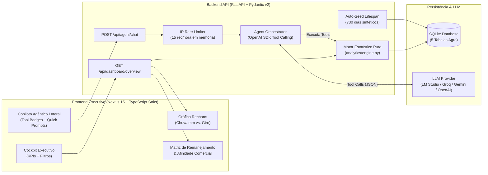

# 🌱 AgroPulse AI — Copiloto Agêntico de Inteligência Comercial e Estoque

[](https://github.com/gui-smoura/agropulse-ai/actions/workflows/ci.yml)


> **Propósito:** Sistema full-stack de inteligência comercial e logística preditiva para distribuidoras de insumos agropecuários (**sementes de pastagem**, **nutrição animal** e **defensivos**). O **AgroPulse AI** cruza 730 dias de histórico de vendas, cobertura de estoque em dias e telemetria pluviométrica (mm) para diagnosticar anomalias climáticas por *Z-score*, mapear a afinidade técnica de consultores e recomendar o remanejamento de lotes entre filiais antes da perda da janela agronômica de plantio.

---

## 🎯 1. O Problema de Negócio e Propósito

Distribuidoras de insumos agropecuários operam sob forte sazonalidade e janelas biológicas curtas. Decisões lentas geram dois prejuízos simultâneos — estoque encalhado em uma região e ruptura de vendas em outra:

1. **Anomalia Climática vs. Sazonalidade:** Um atraso severo de chuvas em uma microrregião (ex.: **Filial Norte — Sinop/MT**) derruba a saída de **Sementes de Pastagem** (>50% de queda) e dispara a demanda emergencial por **Nutrição Seca (Proteinado)**, deixando lotes de alto valor sob risco de perda de germinação/validade.
2. **Desequilíbrio Regional de Estoque:** Enquanto a **Filial Norte** acumula cobertura crítica (>65 dias) pela estiagem, outra unidade com chuva regular (ex.: **Filial Sul — Dourados/MS**) entra em risco de ruptura iminente (<8 dias) e perde vendas na janela ideal de plantio.
3. **Afinidade Consultor–Produto:** Transferir um lote técnico sem direcioná-lo ao perfil comercial certo reduz margem. **Especialistas Técnicos** entregam conversão e margem média ponderada **35% a 45% superiores** em linhas técnicas (Sementes Premium e Defensivos) em comparação com vendedores focados apenas em volume de commodities (sal mineral básico com desconto).

---

## ✨ 2. Principais Funcionalidades

- **Cockpit Executivo Dark (`frontend/`):** Interface em tela única (Next.js 15 + Tailwind CSS + Recharts + Lucide) com:
  - **KPIs Executivos:** Valor em risco de encalhe, anomalias climáticas ativas, oportunidades de remanejamento e diferencial de margem dos especialistas técnicos.
  - **Gráfico Híbrido Chuva × Giro:** Precipitação diária (mm) vs. giro de Sementes e Nutrição Seca com linha de referência do início da estiagem e filtro por filial/janela (`15d`, `30d`, `60d`).
  - **Matriz de Remanejamento & Afinidade:** Tabela acionável de transferências sugeridas (`Origem -> Destino`, cobertura antes/depois, quantidade e consultor recomendado no destino) e comparativo de performance por consultor.
  - **Copiloto Agêntico Lateral:** Chat interativo com 3 prompts rápidos e exibição transparente das ferramentas executadas nos bastidores (`Acionou: <tool_name>`).
- **Motor Estatístico Puro (`backend/app/analytics/`):** Cálculos determinísticos em Python/Pandas/NumPy sobre SQLite (SQLAlchemy 2.0) com contratos `Pydantic v2`.
- **Auto-Seed Resiliente (`lifespan`):** No boot do FastAPI, se o banco SQLite não existir ou estiver vazio, o gerador determinístico popula automaticamente **5 tabelas** com **730 dias** de operação (**4 filiais**, **8 consultores**, **5 produtos**, **2.920 registros de estoque/clima** e **29.200 registros de venda**).
- **Proteção de Demo Público:** Limite por IP em memória na rota de chat (`15 req/hora` por padrão) retornando `HTTP 429` com `Retry-After`.

---

## 🏗️ 3. Arquitetura (Determinístico vs. Probabilístico)

O projeto segue uma separação estrita de responsabilidades: **o LLM jamais realiza cálculos matemáticos**.

- **Camada Determinística (`backend/app/analytics/engine.py`):** Toda agregação financeira, *Z-score* sazonal, correlação de Pearson (precipitação vs. vendas) e cobertura em dias é processada de forma reprodutível em Python/Pandas/NumPy.
- **Camada Agêntica (`backend/app/agent/orchestrator.py`):** Utiliza exclusivamente o SDK padrão `openai` (sem frameworks pesados como LangChain ou CrewAI), compatível com **LM Studio** (local), **Groq**, **Google AI Studio (Gemini)** e **OpenAI**. Caso `LLM_API_KEY` esteja vazio ou o provedor esteja indisponível, um **Fallback Determinístico** executa as mesmas *tools* e sintetiza o diagnóstico executivo com 100% de disponibilidade.



---

## 🧮 4. Motor Analítico e Rotas da API

### Funções Analíticas / Tools (`backend/app/analytics/engine.py`)

1. **`detect_climate_sales_anomalies(filial_id=None, dias_analise=30)`**
   - Compara a janela recente com a mesma estação histórica nos 730 dias, calculando *Z-score* de precipitação e de vendas por produto, além da correlação chuva × giro.
2. **`analyze_consultant_product_affinity(filial_id=None)`**
   - Cruza volume, receita e margem média ponderada por consultor e categoria para identificar campeões em linhas técnicas vs. perfil de volume/commodity.
3. **`recommend_stock_rebalancing(max_coverage_days=60, min_coverage_days=10)`**
   - Calcula a cobertura operacional por filial e produto:

$$\text{Cobertura em Dias} = \frac{\text{Estoque Disponível}}{\text{Média Diária de Vendas (últimos 15 dias)}}$$

   - Pareia origens em excesso crítico (`> max_coverage_days`) com destinos em risco de ruptura (`< min_coverage_days`), definindo quantidade de transferência, valor do lote e consultor recomendado no destino.

### Endpoints FastAPI (`backend/app/main.py`)

| Método | Rota | Descrição |
| :--- | :--- | :--- |
| `GET` | `/api/health` | Status da API e confirmação das 5 tabelas populadas no SQLite. |
| `GET` | `/api/dashboard/overview` | Retorna o consolidado das 3 análises determinísticas para o dashboard sem gastar tokens de LLM. |
| `POST` | `/api/agent/chat` | Recebe `{ "message": str }`, aplica *rate limit* por IP e executa o loop de *Tool Calling* retornando `{ "reply": str, "tools_used": list[str] }`. |

---

## 📁 5. Estrutura do Monorepo

```text
agropulse-ai/
├── .github/workflows/ci.yml               # Pipeline CI (Ruff/Pytest + Typecheck/Lint/Next Build)
├── backend/
│   ├── app/
│   │   ├── main.py                        # Entrypoint FastAPI, CORS, Lifespan (Auto-Seed) e Rotas
│   │   ├── config.py                      # Configurações via Pydantic Settings (.env)
│   │   ├── rate_limit.py                  # Rate limiter em memória por IP para /api/agent/chat
│   │   ├── database/
│   │   │   ├── models.py                  # Schema SQLite / SQLAlchemy 2.0 (5 tabelas)
│   │   │   └── seed_generator.py          # Gerador determinístico de 730 dias de operação
│   │   ├── analytics/
│   │   │   ├── schemas.py                 # Contratos Pydantic v2 (API e Tools)
│   │   │   └── engine.py                  # Funções estatísticas puras (Pandas/NumPy)
│   │   └── agent/
│   │       ├── tools.py                   # Schemas OpenAI Tools e dispatcher validado
│   │       └── orchestrator.py            # Cliente OpenAI-compatible, prompt e fallback
│   ├── tests/
│   │   └── test_analytics.py              # Testes unitários, endpoints e rate limit
│   ├── Dockerfile                         # Container python:3.11-slim não-root
│   └── pyproject.toml                     # Dependências, Ruff e Pytest
├── frontend/
│   ├── src/
│   │   ├── app/                           # App Router (layout.tsx, page.tsx, globals.css)
│   │   ├── components/
│   │   │   ├── kpi-cards.tsx              # Cards executivos de resumo
│   │   │   ├── anomaly-chart.tsx          # Gráfico Recharts Chuva vs. Giro + diagnóstico
│   │   │   ├── rebalance-table.tsx        # Tabela de remanejamento e matriz de afinidade
│   │   │   └── agent-copilot.tsx          # Copiloto lateral com badges de Tools e Quick Prompts
│   │   └── lib/
│   │       └── api.ts                     # Cliente HTTP tipado (TypeScript strict, sem `any`)
│   ├── package.json
│   └── tsconfig.json
├── .env.example                           # Modelo seguro de variáveis de ambiente
├── .gitignore                             # Bloqueia .env, .env.*, *.db, caches e build artifacts
├── DESIGN.md                              # Guia visual do sistema
├── SPEC.md                                # Especificação técnica e arquitetural
└── README.md
```

---

## 🚀 6. Como Executar Localmente

### Pré-requisitos
- **Python 3.11+**
- **Node.js 20+** e **npm**

### 1. Clonar o repositório e configurar variáveis de ambiente (opcional)

```bash
git clone https://github.com/gui-smoura/agropulse-ai.git
cd agropulse-ai
```

> Se quiser conectar um provedor de LLM (Groq, Google AI Studio, OpenAI ou LM Studio local), copie `.env.example` para `backend/.env` e preencha suas credenciais. **Se não criar nenhum `.env`, o sistema já inicia funcionando em modo de fallback determinístico.**

### 2. Iniciar o Backend (FastAPI + Auto-Seed SQLite)

```bash
cd backend
python -m venv .venv

# Windows (PowerShell):
.\.venv\Scripts\Activate.ps1
# Linux / macOS:
# source .venv/bin/activate

pip install -e ".[dev]"
uvicorn app.main:app --reload --port 8000
```

- **Swagger UI:** `http://localhost:8000/docs`
- **Health Check:** `http://localhost:8000/api/health`

### 3. Iniciar o Frontend (Next.js)

Em outro terminal:

```bash
cd frontend
npm install --legacy-peer-deps
npm run dev
```

Acesse o **AgroPulse AI** em `http://localhost:3000`.

### Alternativa com Docker (Backend)

```bash
cd backend
docker build -t agropulse-backend .
docker run -p 8000:8000 --env-file .env agropulse-backend
```

---

## 🔐 7. Variáveis de Ambiente e Segurança

O arquivo [`.gitignore`](.gitignore) bloqueia `.env`, `.env.*` (exceto `.env.example`) e bancos `*.db` para impedir o vazamento acidental de chaves ou dados locais no repositório.

### Backend (`backend/.env`)

| Variável | Descrição | Exemplo |
| :--- | :--- | :--- |
| `DATABASE_URL` | URI SQLAlchemy do SQLite | `sqlite:///./agropulse.db` |
| `LLM_BASE_URL` | Endpoint OpenAI-compatible (Groq, Gemini, OpenAI, LM Studio) | `https://api.groq.com/openai/v1` |
| `LLM_API_KEY` | Chave da API (deixe vazio para fallback determinístico) | `sua_chave_aqui` |
| `LLM_MODEL` | Modelo com suporte a *Tool Calling* | `llama-3.3-70b-versatile` |
| `CORS_ORIGINS` | Origens permitidas separadas por vírgula | `http://localhost:3000` |
| `RATE_LIMIT_MAX_REQUESTS` | Máximo de chamadas por IP na janela (`POST /api/agent/chat`) | `15` |
| `RATE_LIMIT_WINDOW_SECONDS` | Janela do *rate limit* em segundos | `3600` |

**Exemplo para rodar com LM Studio local:**
```env
LLM_BASE_URL=http://127.0.0.1:1234/v1
LLM_API_KEY=lm-studio
LLM_MODEL=seu-modelo-local
```

### Frontend (`frontend/.env.local`)

| Variável | Descrição | Default |
| :--- | :--- | :--- |
| `NEXT_PUBLIC_API_URL` | URL base da API FastAPI | `http://localhost:8000` |

---

## 🧪 8. Testes, Lint e CI/CD

O workflow [`.github/workflows/ci.yml`](.github/workflows/ci.yml) executa automaticamente em cada *push* ou *pull request* para `main`:

```bash
# Backend
cd backend
ruff check .
pytest

# Frontend
cd frontend
npm run typecheck
npm run lint
npm run build
```
